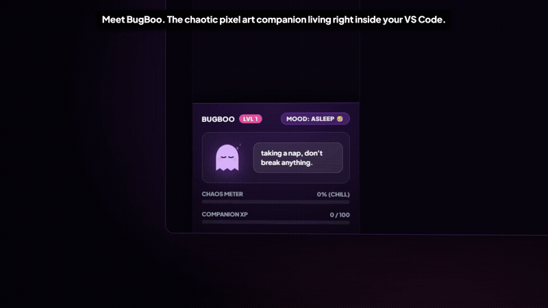
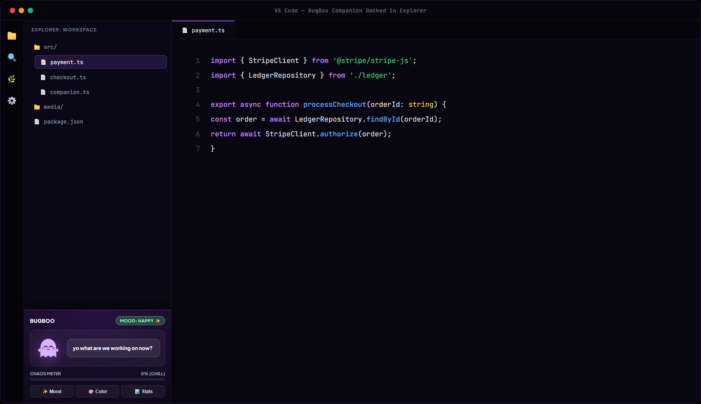
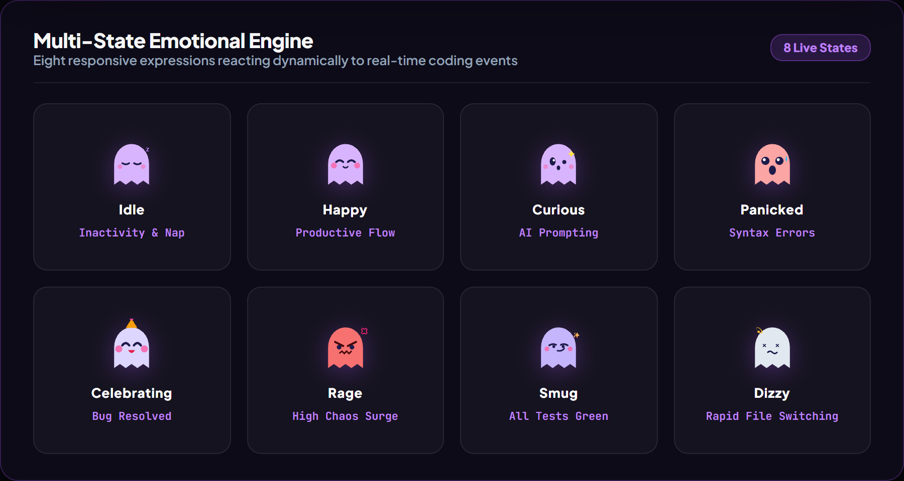
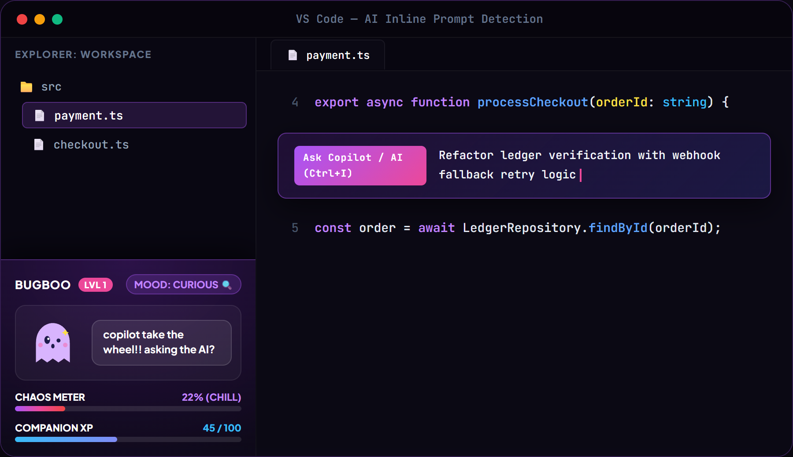
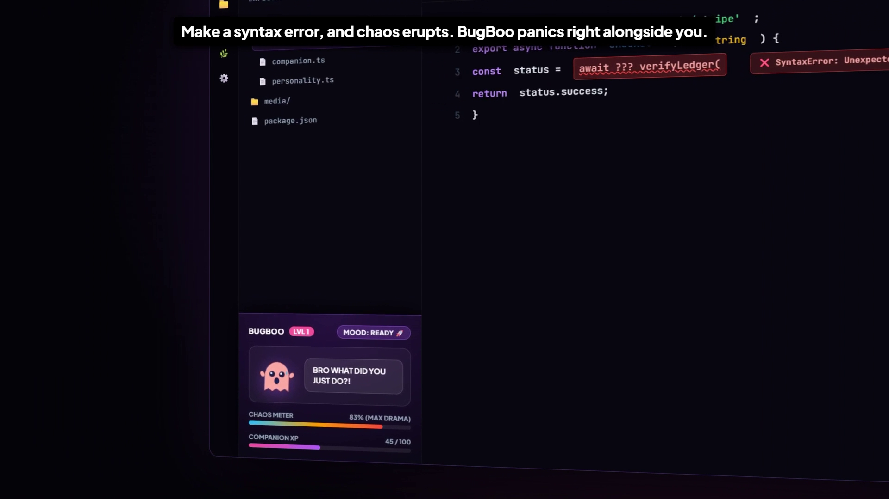

# BugBoo

A lightweight, event-driven pixel-art ghost companion docked directly beneath the Explorer file tree in VS Code, Cursor, and Antigravity.

BugBoo provides real-time ambient feedback based on editor events, file navigation, typing cadence, AI prompts, and syntax diagnostics. It features a dynamic Chaos Meter, 7 customizable color themes, and 8 responsive emotional states—built without polling intervals or background performance penalties.

---

## Showcase

[](https://github.com/kiranmayee-abbireddy/BugBoo/blob/master/BugBoo.mp4)

> 📹 **[Click here to watch the full 1080p video with audio on GitHub (BugBoo.mp4)](https://github.com/kiranmayee-abbireddy/BugBoo/blob/master/BugBoo.mp4)**.
>
> *(Click the preview GIF or link above to open GitHub's native video player with sound).*

---

## Overview



BugBoo resides natively in the primary Explorer sidebar, ensuring continuous visibility without consuming space in your main editor workspace or requiring manual switching between activity tabs.

### Core Highlights

- **Native Explorer Docking**: Integrated directly into the primary file tree view container.
- **Hardware-Accelerated Rendering**: Utilizes isolated CSS 3D transforms (`translate3d`) and GPU compositing.
- **Resource Efficient**: Operates with zero polling loops; diagnostics are debounced and animations sleep when the view is collapsed or hidden.
- **Local & Offline**: Zero network calls, zero external model queries, and zero telemetry. All state is maintained locally within VS Code's extension storage.

---

## Key Features

### 1. Multi-State Emotional Engine



BugBoo dynamically expresses 8 distinct emotional states driven by real-time development activity:

| State | Trigger Context | Description |
|---|---|---|
| **Idle** | Inactivity / Resting | BugBoo sleeps quietly when user is away from keyboard. |
| **Happy** | Productive Flow | Gentle hovering during continuous coding sessions. |
| **Curious** | File Navigation | Observes file switching and project directory browsing. |
| **Panicked** | Syntax / Build Errors | High-alert expression triggered by diagnostics failures. |
| **Celebrating** | Error Resolution | Commemorative party animation upon fixing broken code. |
| **Rage** | High Chaos Spike | Fiery reaction when editor error rate exceeds threshold. |
| **Smug** | Clean Build | Relaxed satisfaction when tests and linting succeed. |
| **Dizzy** | File Thrashing | Disoriented reaction when switching rapidly between files. |

---

### 2. AI Prompt Awareness



BugBoo detects when AI assistance tools (such as GitHub Copilot, Cursor Composer, or Antigravity) are active, providing context-aware remarks and reactions as prompts are composed and executed.

---

### 3. Real-Time Diagnostic Reactions & Chaos Meter



When compiler errors or linter warnings occur, BugBoo responds immediately with visual panic cues and updates the real-time **Chaos Meter**:

- **Chill (0% – 24%)**: Normal development conditions with clean diagnostics.
- **Suspicious (25% – 49%)**: Minor warnings or rapid code modifications.
- **Chaotic (50% – 74%)**: Multiple syntax errors or failing test runs.
- **Maximum Drama (75% – 100%)**: Critical compiler breakage across multiple files.

---

### 4. Avatar Color Customization

Choose between 7 sleek ghost color themes directly from the sidebar or via the Command Palette:

- **Lavender** (Default soft purple)
- **Mint** (Vibrant cyber-green)
- **Cyberpunk** (Electric neon cyan)
- **Rose** (Bubblegum pastel pink)
- **Midnight** (Deep moody violet)
- **Sunshine** (Warm golden amber)
- **Spectral** (Classic spooky off-white)

---

## Command Palette Reference

Access commands via `Ctrl+Shift+P` (or `Cmd+Shift+P` on macOS) by typing `BugBoo`:

| Command | Identifier | Function |
|---|---|---|
| `BugBoo: Summon` | `bugboo.summon` | Reveals and focuses the BugBoo companion view. |
| `BugBoo: Change Mood` | `bugboo.changeMood` | Manually previews any of the 8 emotional expressions. |
| `BugBoo: Customize Avatar Color` | `bugboo.changeColor` | Select from 7 avatar color themes (Lavender, Mint, Cyberpunk, Rose, Midnight, Sunshine, Spectral). |
| `BugBoo: Show Stats` | `bugboo.showStats` | Displays an information notification with current Chaos percentage, mood, and active color theme. |
| `BugBoo: Reset Progress` | `bugboo.resetProgress` | Resets the Chaos meter and restores BugBoo to a chilled state. |

### Configuration

Customize BugBoo through VS Code Settings (`Ctrl+,` or `Cmd+,` searching for `bugboo`):

- `bugboo.avatarColor`: Avatar color theme (`lavender`, `mint`, `cyberpunk`, `rose`, `midnight`, `sunshine`, `spectral`).

---

## Development & Extension Setup

### Prerequisites

- [Node.js](https://nodejs.org/) (version 18.0 or later)
- [Visual Studio Code](https://code.visualstudio.com/) (version 1.85.0 or later)

### Installation

```bash
git clone https://github.com/kiranmayee-abbireddy/BugBoo.git
cd BugBoo
npm install
```

### Build & Test

```bash
# Compile TypeScript sources
npm run compile

# Run automated tests
npm test
```

### Debugging in VS Code

1. Open the project root in VS Code: `code .`
2. Press `F5` to launch an **Extension Development Host** window.
3. Open the Explorer panel to view the docked BugBoo companion.

### Packaging

To generate a `.vsix` distribution package:

```bash
npx @vscode/vsce package
```

---

## License

This project is licensed under the [MIT License](LICENSE).

